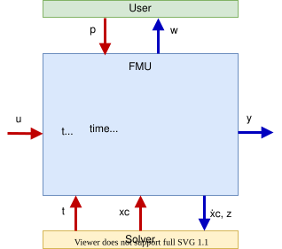
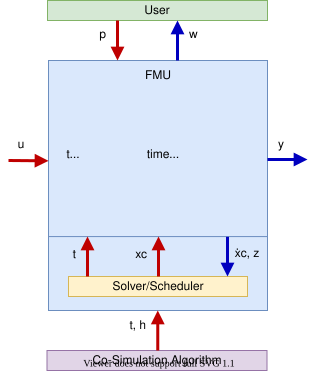
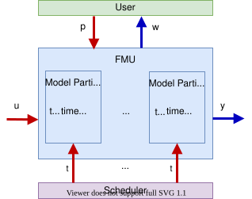

# 第 1 章 为什么需要 FMI

> **第一部分：入门 · 初稿**
> 对应规范：[1. Introduction](https://fmi-standard.org/docs/3.0.2/#_introduction)（本地：[1.2 Overview](../spec-3.0.2/html/index.html#_overview)）
> 预计阅读：25 分钟
> 先修知识：了解"微分方程"和"仿真"的基本概念即可，不需要会用任何建模工具。

## 学习目标

读完本章，你应该能够：

1. 用一句话解释 FMI 和 FMU 分别是什么。
2. 说清 **导出端（exporter）** 和 **导入端（importer）** 的分工。
3. 区分 **Model Exchange（ME）**、**Co-Simulation（CS）**、**Scheduled Execution（SE）** 三种接口，并能为具体场景选型。
4. 知道 FMI 3.0 相对 2.0 主要新增了什么。
5. 知道 FMI **不** 负责哪些事情，避免把工程问题误当成标准问题。

---

## 1.1 一个具体的集成难题

假设你在做一台混合动力汽车的系统仿真，手上有四个模型：

| 模型 | 来源 | 形式 |
| --- | --- | --- |
| 电池包电化学模型 | 电池供应商 | 供应商仿真工具 A 的工程文件 |
| 电机控制器 | 自研 | 一大堆 C 代码 |
| 整车动力学 | OEM | Modelica 模型 |
| 驾驶员模型 | 第三方 | 工具 B 的模型 |

你想在同一个仿真里让它们交换信号、同步时间。现实中的做法通常是：

- 为 A 工具和 B 工具写一个专用适配器；
- 把 C 代码编译成 DLL，再约定一套私有函数名和数据结构；
- 用共享内存 / socket / 文件做联合仿真；
- 每换一个工具版本，再修一遍适配器。

问题在于：**适配成本随工具数量按平方增长**。四个工具两两对接，最多需要 12 条有向适配；十个工具就是 90 条。每条适配都要单独调试、单独维护，而且无法复用到别的项目。

```text
没有标准：                        有 FMI：

  A ──── B                          A ────┐
  │ ╲  ╱ │                          B ────┼── FMI ──> 任意导入端
  │  ╳   │                          C ────┤
  │ ╱  ╲ │                          D ────┘
  C ──── D
  两两专用适配（N×(N-1)）           每个工具只实现一次 FMI（N 次实现 + 1 个标准）
```

FMI 要解决的就是这个"接口爆炸"问题：**把模型怎么交出去、怎么被调用，变成一套所有工具都认的约定**。

---

## 1.2 FMI 到底是什么

规范开篇的定义可以拆成三层：

> "The Functional Mock-up Interface (FMI) defines a ZIP archive and an application programming interface (API) to exchange dynamic models using a combination of XML files, binaries and C code: the Functional Mock-up Unit (FMU)."
>
> —— FMI 3.0.2, 1.2 Overview

换成中文：

- **一个 ZIP 容器**：扩展名是 `.fmu`，里面装着模型相关的一切；
- **一个 XML 描述文件**：`modelDescription.xml`，告诉导入端"我有哪些变量、支持哪些能力"；
- **一套 C API**：以 `fmi3` 开头的函数，导入端通过它创建实例、设参数、推进时间、读写变量；
- **一份实现**：动态库（`.dll` / `.so` / `.dylib` / `.wasm`）**或者** C 源码，二者至少有其一。

所以：

```text
FMU = 模型实现 + modelDescription.xml + 可选资源/文档
FMI = 描述这个容器和调用方式的规范
```

这里要建立第一个重要认知：

> **FMI 是接口标准，不是建模语言，也不是求解器。**
> 它不关心你的模型是电池、飞机还是弹簧振子，也不关心你用什么算法积分。

正因如此，FMI 才能同时被 Dymola、OpenModelica、Simulink、Adams、CarSim 这些完全不同的工具支持。

---

## 1.3 两个角色：谁导出，谁导入

FMI 世界里的所有交互都可以归结为两个角色：

| 角色 | 英文 | 做什么 | 典型例子 |
| --- | --- | --- | --- |
| 导出端 | exporter | 把模型打包成 FMU | Dymola、OpenModelica、Simulink、手写 C 代码 |
| 导入端 | importer | 加载 FMU，按状态机调用 FMI 函数，推进仿真 | fmusim、FMPy、Simulink、各类仿真平台 |

几个容易忽略的事实：

- **同一个工具可以既是导出端又是导入端。** Simulink 既能导出 FMU，也能导入 FMU。
- **FMU 可以嵌套。** 一个 FMU 内部可以再加载别的 FMU（规范明确支持）。
- **导入端可以同时加载很多 FMU。** 一个仿真里跑几十个 FMU、每个 FMU 多个实例，都是正常用法。

本仓库里的 `examples/fmus/` 是别人已经导出的 FMU；`examples/reference-fmus/` 则同时包含"导出端源码"（怎么生成 FMU）和"导入端示例"（怎么调用 FMU）。

---

## 1.4 三种接口类型

FMI 3.0 定义三种接口。它们的区别可以用一句话概括：**谁来负责"推进时间"这件事**。

### 1.4.1 Model Exchange（ME）：导入端提供求解器

ME 把模型暴露成一组方程：

```text
dx/dt = f(x, u, t)      状态导数
y     = g(x, u, t)      输出
z     = h(x, u, t)      事件指示器
```

FMU 只负责**算导数、算输出、算事件指示器**；时间怎么推进、步长取多大、事件怎么迭代，全部由导入端的求解器决定。



*图 1-1　ME：用户 → 导入端求解器 → FMU（来源：FMI 3.0.2 规范，CC BY-SA 4.0）*

在 ME 里，导入端会调用类似这样的函数（第 7 章会逐行讲）：

- `fmi3GetContinuousStateDerivatives`：给我当前状态的导数；
- `fmi3GetEventIndicators`：给我事件指示器的值；
- `fmi3EnterEventMode`：检测到事件，进入事件模式；
- `fmi3CompletedIntegratorStep`：一步积分完成，可以继续。

**适合 ME 的场景：**

- 导入端有成熟、高性能的 ODE/DAE 求解器；
- 需要变步长、精确的事件定位；
- 多个模型需要紧密耦合，由同一个求解器统一协调；
- 你希望 FMU 保持"纯方程"，不绑定某个求解器。

**不适合 ME 的场景：**

- 模型内部有强的刚性、需要专用求解器，而导入端只有通用求解器；
- 只想快速把某个工具的模型拿过来跑，不想关心求解器配置；
- 模型包含无法用 ODE 形式表达的内部调度逻辑。

### 1.4.2 Co-Simulation（CS）：FMU 自带求解器

CS 把"模型 + 求解器（可能还有调度器）"一起打包。导入端不再关心内部怎么积分，只需要说：

> "从当前时间开始，往前推进 `h` 秒。"

对应函数是 `fmi3DoStep`。FMU 内部可以用任意小步长、任意算法，推进到 `currentTime + h` 后返回。



*图 1-2　CS：用户 → 导入端协同算法 → FMU（来源：FMI 3.0.2 规范，CC BY-SA 4.0）*

CS 的关键概念是**通信步长（communication step size）**：

- 导入端每一步只和 FMU 交换一次数据；
- FMU 内部可能已经积分了很多小步；
- 通信步长越大，耦合精度越低，但速度越快。

FMI 3.0 为 CS 增加了几个提高鲁棒性的机制：

- **早返回（early return）**：FMU 发现内部有事件，可以提前从 `fmi3DoStep` 返回，而不是硬走完整个通信步；
- **事件模式（Event Mode）**：在通信步之间处理离散事件；
- **中间更新（intermediate update）**：FMU 在内部步进过程中回调导入端，交换中间结果。

**适合 CS 的场景：**

- 模型来自商业工具，内部求解器是工具的核心资产，不想暴露；
- 各子系统使用不同的求解器，需要"黑盒"耦合；
- 模型包含内部调度、状态机、采样逻辑，难以写成纯 ODE；
- 想快速集成，优先考虑工程可用性而不是极致精度。

**CS 的代价：**

- 通信步长会引入额外误差；
- 导入端对模型内部事件的控制能力较弱；
- 代数环（algebraic loop）需要额外处理。

### 1.4.3 Scheduled Execution（SE）：导入端提供调度器

SE 是 FMI 3.0 新增的接口，面向 **vECU（虚拟电子控制单元）**、实时系统和多速率模型。

它把模型拆成若干**模型分区（model partition）**，每个分区绑定到一个 **Clock**。导入端的调度器决定"什么时候激活哪个分区"：

```text
导入端调度器
   │  Clock A 到点 → fmi3ActivateModelPartition(clockA)
   │  Clock B 到点 → fmi3ActivateModelPartition(clockB)
   ▼
FMU 内的模型分区 A / B / C
```



*图 1-3　SE：用户 → 导入端调度器 → FMU 的模型分区（来源：FMI 3.0.2 规范，CC BY-SA 4.0）*

规范给了一个很形象的对称关系：

- **ME 把求解器外置**给导入端；
- **SE 把调度器外置**给导入端。

**适合 SE 的场景：**

- 控制器代码按固定周期执行（1 ms、10 ms、100 ms 等多速率任务）；
- 实时平台/HIL 平台需要精确控制每个任务的执行时刻；
- 需要把 vECU 导出成 FMU，而不是把整个控制器塞进 CS 的 `DoStep`。

SE 在 3.0 中相对年轻，工具支持不如 ME/CS 普遍。学习时可以先掌握 ME/CS，再回头看 SE。

### 1.4.4 三种接口对比与选型

| 维度 | Model Exchange | Co-Simulation | Scheduled Execution |
| --- | --- | --- | --- |
| 谁推进时间 | 导入端求解器 | FMU 内部求解器（`fmi3DoStep`） | 导入端调度器（按 Clock 激活分区） |
| FMU 内含求解器 | 否 | 可能有 | 可能有 |
| FMU 内含调度器 | 可能有 | 可能有 | 否 |
| 事件指示器 | 有 | 无（通过事件模式/Clock 处理） | 无 |
| 直接馈通 | 有 | 仅事件模式 | 无 |
| 典型用途 | 紧耦合系统仿真、控制系统设计 | 工具间联合仿真、模型保护 | 实时系统、vECU、多速率调度 |
| 集成难度 | 中（导入端要有求解器） | 低（黑盒） | 高（需要调度器支持） |

> 上表的"事件指示器/直接馈通"部分参考规范 1.2 的 Feature Overview 表；完整定义见后续各章。

**一个实用的选型顺序：**

1. 你的模型是**按固定节拍执行的控制器/实时任务**吗？→ 先看 SE。
2. 模型**自带求解器**，或者你想隐藏模型内部、快速集成？→ 选 CS。
3. 导入端有求解器，且你需要**精确事件、变步长、紧耦合**？→ 选 ME。
4. 不确定？→ 先看导出工具支持什么，再按"集成成本优先"选 CS，"精度/控制优先"选 ME。

最后强调一点：**一个 FMU 可以同时支持多种接口**。本仓库的 `examples/fmus/3.0/BouncingBall.fmu` 就同时声明了 ME 和 CS：

```xml
<ModelExchange modelIdentifier="BouncingBall" ... />
<CoSimulation  modelIdentifier="BouncingBall" ... />
```

导入端根据自身能力和使用场景，选择其中一种方式实例化。它不是"二选一"的容器格式。

---

## 1.5 FMI 3.0 带来了什么

FMI 3.0 于 2022 年 5 月发布，3.0.2 是 2024 年 11 月的维护版本（只做澄清和修正，不引入新特性）。相对 2.0，主要变化可以分成四组：

### 面向 vECU 和控制代码

| 新能力 | 解决什么问题 |
| --- | --- |
| **Scheduled Execution** | 让外部调度器按任务周期激活模型分区，贴近真实 ECU 的调度方式 |
| **Clock** | 精确描述周期性、触发式、通信点时钟，支持多速率 |
| **Terminals / Icons** | 按语义对变量分组，描述连接关系和图标，便于图形化集成 |
| **更多整数类型 + Float32** | 直接映射控制器里的 `int8/16/32/64`、`float`，减少转换 |
| **Binary 类型** | 传输非数值数据（复杂传感器报文、图像、序列化结构） |
| **数组变量** | 原生支持向量/矩阵，不必拆成一堆标量 |
| **结构参数** | 运行时可修改数组维度，支持在线标定 |

### 面向 Co-Simulation 的鲁棒性

- **早返回（Early Return）**：`fmi3DoStep` 可以因为内部事件提前返回；
- **事件模式（Event Mode）**：在通信步之间处理离散状态；
- **中间更新（Intermediate Update）**：FMU 在内部步进时回调导入端；
- **Clock 与时钟变量**：更精细地控制事件时刻。

### 工程化

- **源码 FMU 的构建描述** `buildDescription.xml`，让"拿到源码就能编译"变得标准化；
- **分层标准（Layered Standards）**：在 FMI 之上扩展领域能力（如总线通信、XCP 标定、WASM、结构化数据）；
- **方向导数 / 伴随导数**：为优化、AI 训练等场景提供梯度信息。

### 移除的内容

- FMI 2.0 CS 的**异步模式**（工具支持极少，可用多进程/多线程替代）；
- `fmi2SetRealInputDerivatives`（由中间更新模式下的输入设置替代）。

> 完整列表见规范 [1.1 What is new in FMI 3.0](../spec-3.0.2/html/index.html#fmi-whats-new)，以及本仓库的 [3.0.2 发布说明](../spec-3.0.2/CHANGELOG.md)。

---

## 1.6 FMI 不负责什么

很多人第一次接触 FMI 会产生一些不切实际的期待。明确边界，能少走很多弯路。

**FMI 不规定模型内部怎么实现。**
你可以用任何语言、任何数据结构、任何求解器，只要最终导出符合规范的 C 接口。规范甚至明确说"不规定表示模型的数据结构"。

**FMI 不保证 FMU 跨平台。**
一个 FMU 只有在包含对应平台的二进制，或者包含可编译源码时，才能在目标平台运行。只带了 `x86_64-windows` 的 DLL，拿到 Linux 上是跑不起来的。

**FMI 不校验模型的物理正确性。**
单位写错、参数范围不合理、方程推导错误，FMI 都不知道。它只保证"接口能调通"，不保证"结果是对的"。

**FMI 不规定求解器和步长算法。**
ME 的积分算法完全由导入端决定；CS 的内部算法完全由 FMU 决定。同一个 FMU 在不同导入端里可能得到不同精度的结果。

**FMI 不自动做单位换算。**
`modelDescription.xml` 可以描述单位（`m`、`m/s`），但导入端是否换算、怎么换算，取决于工具。变量单位的一致性仍然需要人保证。

**FMI 不负责参数界面、可视化和实验管理。**
这些是导入端或上层工具的职责。FMI 只提供"读参数、写参数、推进时间"的底层能力。

**ME FMU 不能独立运行。**
它没有求解器，必须由导入端驱动。把 ME FMU 双击打开是不会有任何结果的。

---

## 1.7 生态与工具

FMI 是目前工业界使用最广泛的模型交换标准之一。官方工具目录（[fmi-standard.org/tools](https://fmi-standard.org/tools/)）按导入/导出方向、支持的接口类型和平台分类收录工具，数量仍在持续增长。

学习阶段，你不需要商业工具也能完成大部分练习：

| 工具 | 作用 | 获取方式 |
| --- | --- | --- |
| **fmusim** | 官方命令行导入端：检查、验证、仿真 FMU | <https://modelica.github.io/fmusim/> |
| **FMPy** | Python 导入端，适合写脚本和做数据处理 | <https://github.com/CATIA-Systems/FMPy> |
| **Reference FMUs** | 官方手写 FMU，覆盖各种特性 | 本仓库 `examples/reference-fmus/` |
| **OpenModelica** | 开源建模工具，可导出 FMU | <https://openmodelica.org/> |

本仓库已经把规范和参考实现都离线准备好了：

- 规范：`docs/spec-3.0.2/html/index.html`
- 预编译 FMU：`examples/fmus/3.0/`
- FMU 源码：`examples/reference-fmus/`
- 导入端示例：`examples/reference-fmus/examples/simulate_fmi3_me.c`、`simulate_fmi3_cs.c`

---

## 1.8 如何使用这份讲义

每一章都按同样的结构组织：

1. **学习目标**：读完能做到什么；
2. **对应规范章节**：方便对照原文；
3. **概念讲解**：用中文解释"为什么"；
4. **代码/XML 实例**：全部来自本仓库，可直接运行；
5. **动手实验**：至少一个可操作的练习；
6. **小结 + 习题**：检查是否真的理解。

阅读规范时有两个小技巧：

- 本地 HTML 页面顶部是自动生成的目录（TOC），点击标题即可跳转；每个标题都带锚点，可以直接把 `#anchor` 拼到链接后面。
- 找不到某个术语时，先在 HTML 里用浏览器搜索，再查附录 A 的术语表；`docs/spec-3.0.2/adoc/` 下是同一份规范的 AsciiDoc 源文件，适合全文检索。

---

## 1.9 小结

- FMI 用 **ZIP 容器 + XML 描述 + C API** 解决模型交换的接口爆炸问题。
- **FMU** 是容器，**FMI** 是规范；FMU 里至少有二进制或源码中的一种实现。
- **导出端**生成 FMU，**导入端**加载并驱动 FMU。
- 三种接口的核心区别是"谁推进时间"：
  - **ME**：导入端求解器推进；
  - **CS**：FMU 内部求解器推进；
  - **SE**：导入端调度器按 Clock 激活分区。
- 一个 FMU 可以同时支持多种接口。
- FMI 3.0 的重点是 vECU、Clock、数组、二进制、SE 和 CS 鲁棒性。
- FMI 只管接口，不管模型正确性、跨平台能力和单位一致性。

---

## 习题

### 1. 概念自测

不看讲义，用自己的话解释：

- FMU 和 FMI 的区别；
- 导出端和导入端的分工；
- ME 和 CS 最本质的区别。

### 2. 选型练习

为下列场景选择最合适的接口类型，并说明理由：

1. 你有一个包含专用刚性求解器的电池模型，想耦合到整车的 Simulink 模型里；
2. 你有一个控制器 C 代码，需要按 1 ms / 10 ms / 100 ms 三个周期执行，并接入 HIL 平台；
3. 你有一组方程形式的弹簧-质量系统，希望用导入端的高精度变步长求解器统一积分。

<details>
<summary>参考答案</summary>

1. **CS**。模型自带求解器，且希望黑盒集成；通信步长需要根据精度要求调小。
2. **SE**。多速率、固定节拍、由外部调度器激活模型分区，正是 SE 的设计目标。
3. **ME**。模型以方程形式给出，导入端有求解器，且需要变步长和精确事件处理。

</details>

### 3. 规范检索

在本地规范 `docs/spec-3.0.2/html/index.html` 中完成：

1. 找到 1.2 节中定义 FMI 的那句话，记下它的锚点；
2. 找到"本文档不描述如何从建模环境生成 FMU"这句话；
3. 找到三种接口的数据流图，分别对应哪三张图？

<details>
<summary>提示</summary>

- 1.2 节锚点：`#_overview`；
- "This document does not describe how to generate an FMU..." 在 1.2 节开头附近；
- 三张图分别在 1.2.1 / 1.2.2 / 1.2.3 小节。

</details>

### 4. 观察真实 FMU

打开 `examples/reference-fmus/BouncingBall/FMI3.xml`：

1. 这个 FMU 同时声明了哪两种接口？
2. 两种接口的 `modelIdentifier` 是否相同？
3. 它有没有声明 `ScheduledExecution`？

<details>
<summary>参考答案</summary>

1. `ModelExchange` 和 `CoSimulation`；
2. 相同，都是 `BouncingBall`；
3. 没有，因此它不支持 SE。

</details>

### 5. 思考题

为什么 ME 需要"事件指示器"，而 CS 不需要？

<details>
<summary>提示</summary>

ME 的求解器在导入端，它需要知道"什么时候发生了事件"才能正确截断积分步长；CS 的求解器在 FMU 内部，事件由 FMU 自己检测和处理，再通过早返回/事件模式通知导入端。

</details>

---

## 下一章

第 1 章建立了概念。下一章我们直接拆开一个真实的 `.fmu` 文件，看看里面到底装了什么，以及导入端是如何把这些文件用起来的。

→ [第 2 章 解包一个 FMU](02-unpack-fmu.md)
